# Quick Start — Práticas de CMOS no Cadence Virtuoso

Versão visual: [roteiro em PDF](../pdfs/praticas_cmos.pdf), com as capturas e etapas organizadas por aula. Na adaptação para apresentação, os terminais MOS são nomeados Source, Gate e Drain.

Documento em construção a partir das montagens e capturas reais do minicurso. Este roteiro é separado das apresentações existentes.

## Percurso das três aulas

| Aula | Prática | Células previstas |
| --- | --- | --- |
| 1 | Caracterização de NMOS e PMOS: corrente em função das tensões | `a1_tb_nmos`, `a1_tb_pmos` |
| 2 | Redes pull-up/pull-down, inversor, NAND e NOR | `a2_inv`, `a2_nand2`, `a2_nor2` e respectivos testbenches |
| 3 | Layout de um inversor e verificações DRC/LVS | `a3_inv`, `a3_tb_inv` |

Ambiente observado nas capturas: Virtuoso Studio IC23.1, biblioteca tecnológica `gpdk045`. O fluxo de simulação será documentado no ADE Assembler, conforme a sessão utilizada nas capturas. O ADE Explorer também aparece como opção de abertura, mas seus passos específicos não foram registrados. Os próximos módulos serão preenchidos à medida que forem executados; o primeiro resultado registrado é a família de curvas DC do NMOS, descrita ao final desta etapa. As variáveis e a parametrização de vgs estão documentadas; ainda faltam as capturas da configuração dos modelos e da seleção da saída para completar o passo a passo.

## Aula 1 — Preparar o teste do NMOS

**Objetivo desta etapa:** criar o schematic e selecionar os componentes necessários à polarização independente da porta e do dreno.

### 1. Criar a biblioteca

No Library Manager, abra **File → New → Library**. Use o nome `minicurso_cmos` e vincule a biblioteca à tecnologia existente `gpdk045`.

A captura registra o acesso ao menu. A janela de vinculação tecnológica ainda precisa ser capturada para completar esta etapa.

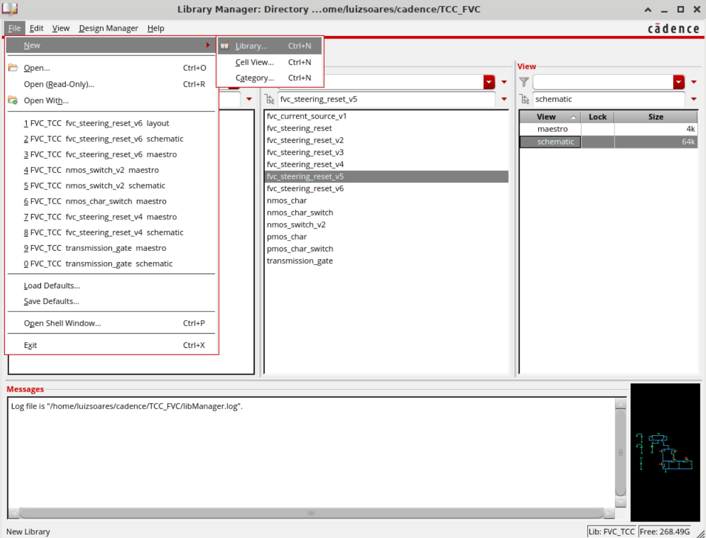

### 2. Criar a célula de teste

Abra **File → New → Cell View**.

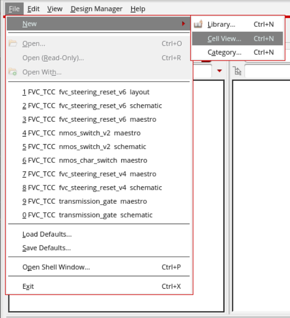

Preencha conforme a captura:

| Campo | Valor |
| --- | --- |
| Library | `minicurso_cmos` |
| Cell | `a1_tb_nmos` |
| View | `schematic` |
| Type | `schematic` |
| Open with | `Schematics L` |

Clique em **OK**.

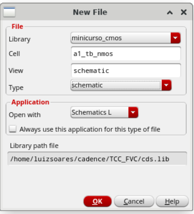

Confira no título do editor a biblioteca, a célula e a vista abertas.

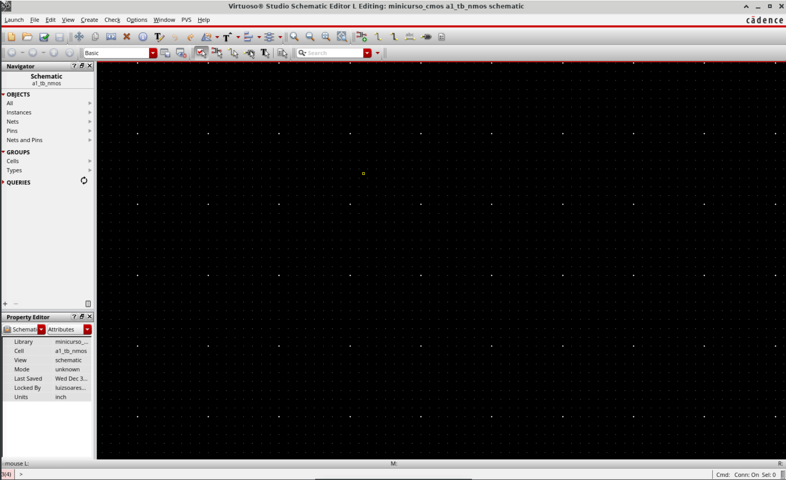

### 3. Inserir o transistor

Com o foco na área do schematic, pressione **i** (bindkey para inserir instância neste ambiente). Na janela **Add Instance**, selecione a biblioteca `gpdk045`, célula `nmos1v` e vista `symbol`. Posicione uma instância e pressione **Esc** para encerrar a inserção.

Parâmetros observados na captura, mantidos como ponto de partida:

| Parâmetro | Valor |
| --- | --- |
| Model Name | `g45n1svt` |
| Length | `45n` (45 nm) |
| Finger Width / Total Width | `120n` (120 nm) |
| Fingers | `1` |
| Multiplier | `1` |

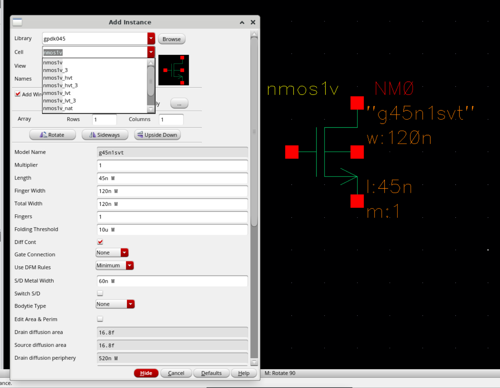

O símbolo possui quatro terminais. Na orientação mostrada: porta à esquerda, dreno acima, fonte abaixo e corpo à direita. A ligação do corpo será explícita no circuito de teste.

### 4. Inserir as fontes DC

Pressione **i** novamente. Selecione `analogLib` → `vdc` → `symbol`.

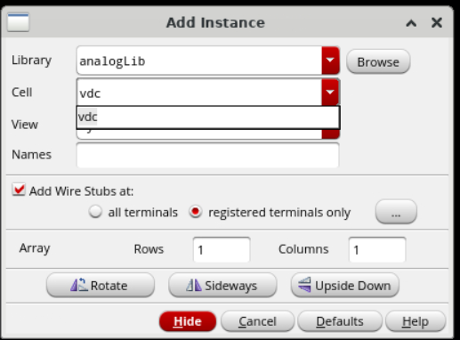

Para as curvas do NMOS, use duas fontes independentes: uma entre porta e referência, outra entre dreno e referência. Os valores e as variáveis de varredura serão registrados na próxima etapa, após conferir as propriedades das fontes e o ADE.

### 5. Inserir os símbolos de referência

Em **Add Instance**, selecione `analogLib` → `gnd` para a referência de terra. A captura específica de seleção de `gnd` ainda precisa ser acrescentada.

A seleção de `analogLib` → `vdd` está registrada abaixo. Esse símbolo identifica uma rede de alimentação; **não gera tensão**. A tensão é aplicada por uma fonte, como `vdc`. O símbolo `vdd` é opcional neste teste com duas fontes independentes.

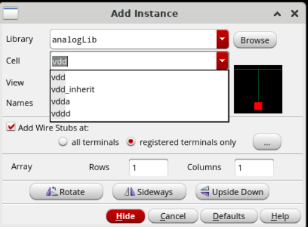

### 6. Próxima montagem: conexões a conferir

| Terminal | Conexão planejada |
| --- | --- |
| Fonte (S) | Terra |
| Corpo (B) | Terra, junto à fonte |
| Porta (G) | Terminal positivo da fonte de controle |
| Dreno (D) | Terminal positivo da fonte de polarização do dreno |
| Terminais negativos das duas fontes | Terra |

Com fonte e corpo em terra, a tensão da porta corresponde a VGS e a do dreno corresponde a VDS. Essa montagem permite variar uma tensão enquanto a outra permanece fixa.

**Checkpoint:** capturar o circuito completamente conectado e as propriedades das duas fontes. Depois conferir o schematic, configurar os modelos e executar a primeira análise DC no ADE Explorer.

### 7. Configurar os componentes, a alimentação e conferir as ligações

Use a montagem abaixo como referência. Fonte e corpo do NMOS compartilham o terra; porta e dreno são polarizados por fontes independentes.

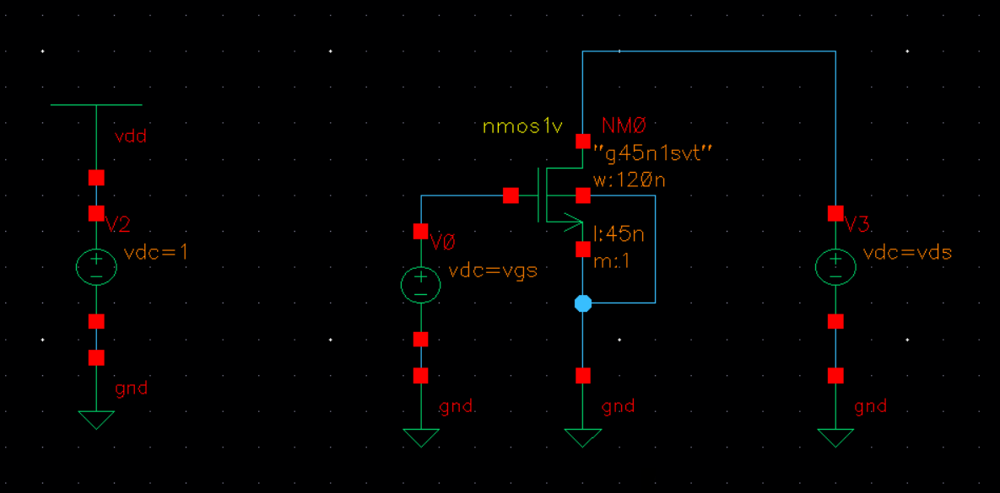

| Fonte | Campo DC voltage | Função |
| --- | --- | --- |
| `V0` | `vgs` | Polarizar a porta em relação ao terra |
| `V3` | `vds` | Polarizar o dreno em relação ao terra |
| `V2` | `1` (1 V) | Estabelecer a alimentação demonstrativa da rede `vdd` |

As expressões `vgs` e `vds` serão definidas no ADE. A janela de propriedades abaixo corresponde a **V2**, configurada em **1 V**.

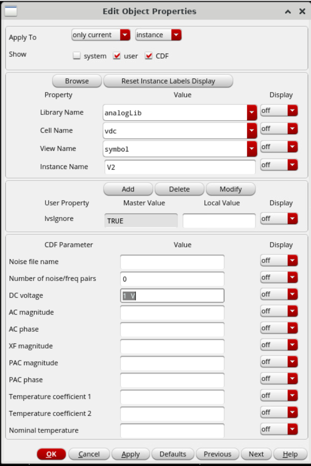

**Por que manter V2 e o símbolo vdd?** A fonte estabelece a diferença de potencial em relação ao terra; os símbolos identificam e conectam redes. Em circuitos maiores, repetir os símbolos de alimentação apropriados permite distribuir VDD e terra sem desenhar fios atravessando todo o schematic. Conferir os nomes efetivos das redes, incluindo a indicação de rede global (`!`) quando aplicável: um pino local e uma rede global de nomes parecidos não são necessariamente a mesma conexão.

Neste teste, V2 e o símbolo `vdd` são mantidos para essa explicação didática. A rede VDD não está ligada à porta nem ao dreno do NMOS; portanto, V2 não determina os valores de `vgs` ou `vds`.

As propriedades de `NM0` confirmam `gpdk045/nmos1v`, modelo `g45n1svt`, comprimento `45n`, largura total `120n`, um finger e multiplicador 1. Manter esses valores nesta primeira montagem. O campo `Bodytie Type = None` não substitui a conexão explícita do terminal de corpo no schematic.

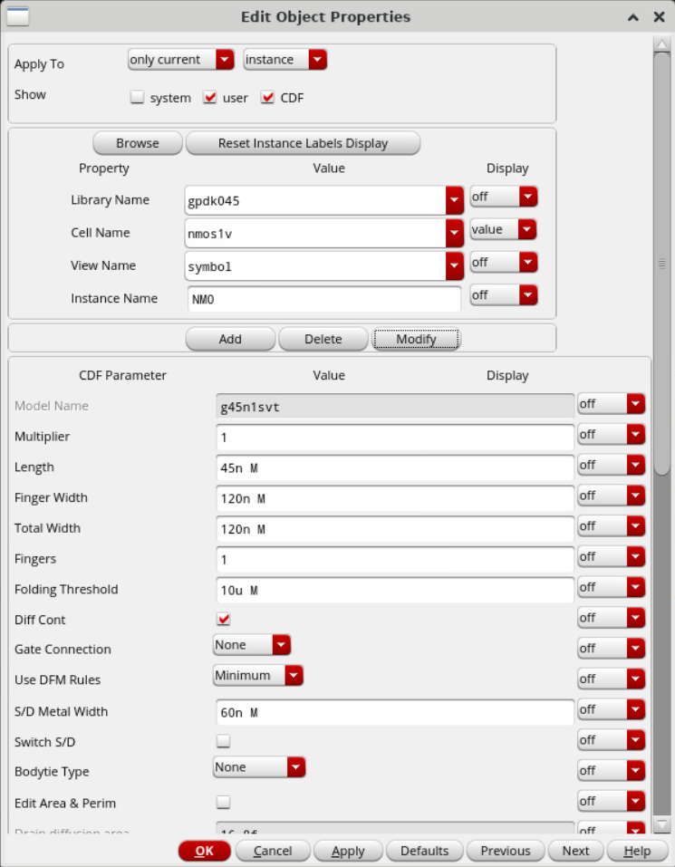

**Checkpoint antes do ADE:** confirmar as conexões dos terminais negativos das fontes ao terra e a união entre fonte e corpo do NMOS; executar **Check and Save** e examinar os avisos; conferir as propriedades de V0 e V3. A proximidade gráfica não garante continuidade elétrica. Depois abrir o **ADE Assembler** para configurar modelos, variáveis e análise DC. Ainda não há simulação validada.

### 8. Abrir o ADE Assembler

No editor de schematic, abra **Launch → ADE Assembler**. O menu também oferece **ADE Explorer**; neste roteiro, acompanhar as telas do Assembler utilizadas na prática.

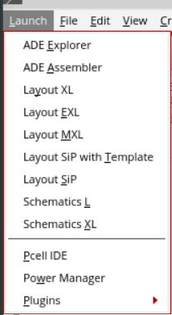

A tela inicial apresenta a sessão de simulação, com a aba `maestro` e o painel **Data View**. Na captura inicial, ainda não há testes configurados.

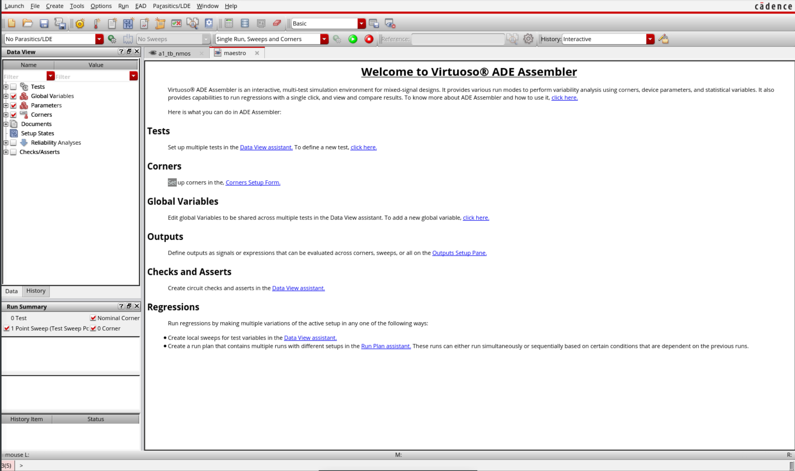

### 9. Criar o teste do NMOS

Na página inicial, a seção **Tests** oferece o link para definir um novo teste. Criar um teste associado ao schematic `minicurso_cmos/a1_tb_nmos`. A janela intermediária de criação e seleção do design ainda precisa ser capturada para completar o passo a passo.

O painel **Data View** organiza testes, variáveis globais, parâmetros e corners. Variáveis globais devem ser usadas quando se deseja compartilhar valores entre testes; para a primeira caracterização, registrar as variáveis no próprio teste.

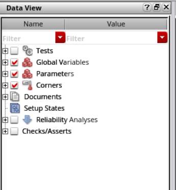

Após a criação, a captura mostra o teste `minicurso_cmos_a1_tb_nmos_1`, com **Simulator = spectre**, a seção **Analyses** e a seção **Design Variables**.

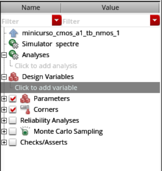

### 10. Definir as variáveis e parametrizar VGS

Em **Design Variables**, registrar as variáveis com os mesmos nomes usados nas fontes do schematic: `vds` e `vgs`.

Na captura, `vds` tem valor de referência **500m** (0,5 V). Durante a análise DC do ponto 11, esse valor é substituído pelos pontos da varredura de **0 a 1 V** definida na própria análise.

Para `vgs`, abrir o editor de parametrização da variável e preencher a janela **Parameterize**:

| Campo | Valor registrado |
| --- | --- |
| Especificação | `From/To` |
| Step Type | `Auto` |
| From | `100m` (0,10 V) |
| To | `700m` (0,70 V) |
| Total Steps | `5` |

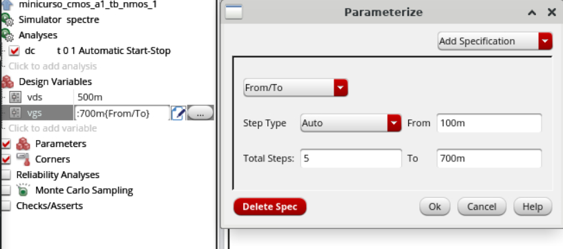

Confirmar em **OK**. A família de curvas registrada no ponto 13 confirma cinco valores: **0,10; 0,25; 0,40; 0,55 e 0,70 V**.

As duas varreduras têm funções distintas: para cada valor parametrizado de **VGS**, executar a análise DC variando **VDS** de 0 a 1 V. Assim, cada curva mostra ID em função de VDS para um VGS fixo. Salvar a configuração da sessão para reutilizar o teste.

O menu de análises também oferece transiente (`tran`), para observar a evolução no tempo, e AC, para resposta de pequenos sinais em frequência. Nesta etapa, utilizar **DC com varredura**, conforme o ponto 11.

### 11. Configurar a varredura DC de VDS

Na janela **Choosing Analyses**, selecionar **dc** e preencher conforme a captura:

| Campo | Configuração registrada |
| --- | --- |
| Save DC Operating Point | Marcado |
| Sweep Variable | `Design Variable` |
| Variable Name | `vds` |
| Sweep Range | `Start-Stop` |
| Start / Stop | `0` / `1` V |
| Sweep Type | `Automatic` |
| Enabled | Marcado |

Confirmar em **OK**. A janela de seleção de análise aparece com o título **ADE Explorer**, embora a sessão principal registrada seja do Assembler; esta captura documenta o formulário efetivamente utilizado.

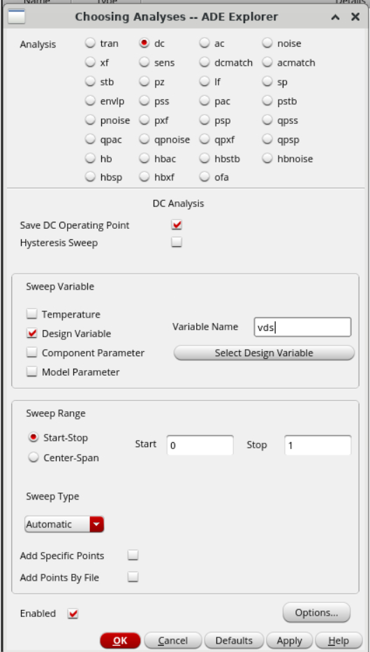

Esta análise varia a tensão da fonte de dreno. Para gerar uma família de curvas, repetir a análise para diferentes valores de `vgs`. A legenda do resultado registra **0,10; 0,25; 0,40; 0,55 e 0,70 V**. A parametrização adicional de `vgs` está documentada no ponto 10; a janela DC acima define a varredura de `vds`.

### 12. Selecionar a corrente de saída e executar

O menu de adição de saídas oferece **Signal** e **Expression**, entre outras opções. Para esta caracterização, adicionar como saída a corrente no terminal de dreno de `NM0`; no gráfico enviado, ela aparece como **`/NM0/D`**. Selecionar o terminal para medir corrente, distinguindo-o da seleção de uma rede para medir tensão. A etapa de seleção no schematic e a tabela final de saídas ainda precisam de captura.

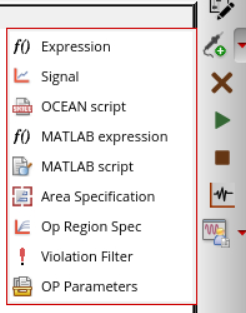

Após conferir análise, variáveis, modelos e saída, executar a simulação pelo botão triangular verde. O botão quadrado é o controle de parada. Salvar a configuração da sessão para repetir o teste.

### 13. Interpretar a família de curvas do NMOS

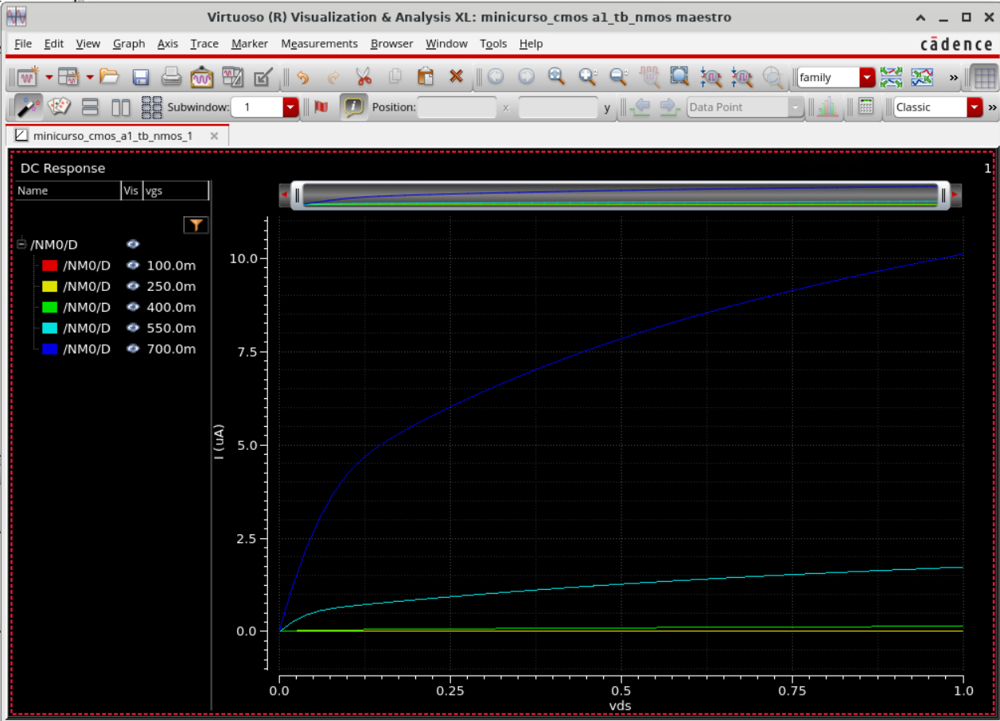

O gráfico registrado apresenta:

- **Eixo horizontal:** `vds`, de 0 a 1 V.
- **Eixo vertical:** corrente no dreno, em microampères.
- **Cinco curvas:** uma para cada valor de `vgs` indicado na legenda.
- **Tendência observada:** a corrente aumenta ao elevar `vgs`. Para `vgs = 0,70 V`, a curva chega aproximadamente a 10 µA em `vds = 1 V`.

Para cada curva, observar o crescimento inicial da corrente e a mudança de inclinação ao aumentar VDS. A curva de maior corrente continua crescendo de modo perceptível na região de VDS elevado: não esperar um patamar perfeitamente horizontal nem usar esse gráfico isolado para extrair um limiar exato. A identificação quantitativa da região de operação deve ser apoiada pelos parâmetros de ponto de operação do modelo, se for incluída na prática.

**Perguntas para a turma:** qual curva corresponde à maior condução? O que muda ao elevar VGS mantendo VDS fixo? A corrente fica rigorosamente constante depois da mudança de inclinação? As curvas próximas do eixo permitem concluir que a corrente é exatamente zero?

**Checkpoint:** o primeiro resultado de simulação foi registrado. As variáveis e as duas varreduras já estão documentadas nos pontos 10 e 11. Para fechar sua reprodução no roteiro, acrescentar a configuração dos modelos e a seleção da corrente de dreno. Depois preparar a curva **ID × VGS**, mantendo VDS fixo, antes de passar ao PMOS.

## Aula 1 — PMOS

Na célula `a1_tb_pmos`, foi repetido o procedimento de montagem e simulação DC utilizado no NMOS, adaptando as ligações e as polaridades para o PMOS.

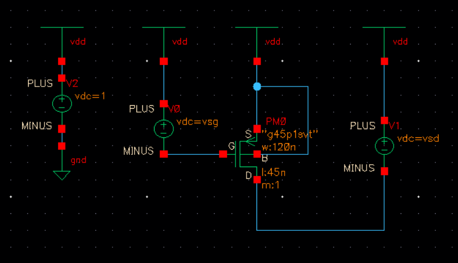

O transistor `PM0` utiliza o modelo `g45p1svt`, com **L = 45 nm**, **W = 120 nm** e multiplicador **1**, conforme as anotações do schematic. Fonte e corpo estão ligados à rede VDD, alimentada por `V2 = 1 V`. As fontes de controle usam **`vsg`** e **`vsd`**:

- **VSG = VS − VG:** fonte de controle com terminal positivo na fonte do PMOS e negativo na porta.
- **VSD = VS − VD:** fonte de polarização com terminal positivo na fonte do PMOS e negativo no dreno.

Repetir a análise DC com `vsd` variando de **0 a 1 V** e a parametrização de `vsg` nos mesmos cinco valores utilizados para o NMOS: **0,10; 0,25; 0,40; 0,55 e 0,70 V**. O procedimento é o mesmo, substituindo os nomes das variáveis e respeitando as polaridades acima. A captura do resultado mostra a família em função de `vsd`; os valores individuais de `vsg` não estão expandidos na legenda dessa imagem.

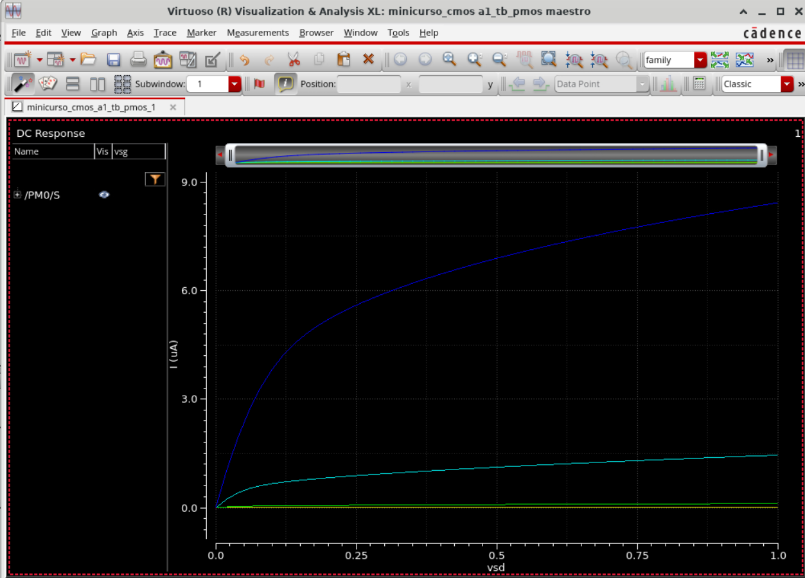

**Atenção à corrente selecionada:** no NMOS, o resultado registrado foi `/NM0/D`; neste PMOS, a saída exibida é **`/PM0/S`**, corrente no terminal de fonte, em µA. Manter essa identificação na comparação: não apresentar a curva positiva do PMOS como uma corrente de dreno com a mesma convenção de sinal do NMOS.

**O que observar:** aumentar VSG aumenta a condução do PMOS, assim como aumentar VGS aumenta a condução do NMOS. Comparar a forma das curvas considerando os terminais medidos e as polaridades. Não exigir correntes idênticas dos dois dispositivos apenas por terem o mesmo W e L.

## Aula 2 — Portas CMOS

### 1. Montar o inversor CMOS

Montar um inversor com um PMOS `gpdk045/pmos1v` e um NMOS `gpdk045/nmos1v`, conforme a captura. Os dois dispositivos têm **W = 120 nm**, **L = 45 nm** e multiplicador **1**. A fonte de alimentação `vdc` aplica **1 V** entre VDD e terra.

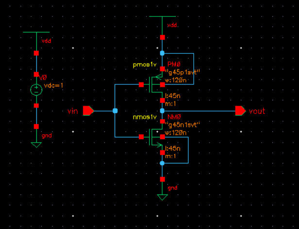

| Conexão | Montagem |
| --- | --- |
| Entrada `vin` | Portas do PMOS e do NMOS unidas |
| Saída `vout` | Drenos do PMOS e do NMOS unidos |
| Fonte e corpo do PMOS | VDD |
| Fonte e corpo do NMOS | Terra |

O PMOS forma a rede **pull-up**, que fornece o caminho para carregar a saída a partir de VDD. O NMOS forma a rede **pull-down**, que fornece o caminho para descarregar a saída até o terra.

**Previsão antes da simulação:** com `vin = 0 V`, esperar saída próxima de 1 V; com `vin = 1 V`, esperar saída próxima de 0 V. Confirmar esses resultados nas análises seguintes. Os dois transistores foram mantidos com as mesmas dimensões nesta montagem; não presumir que isso coloca o ponto de comutação exatamente em 0,5 V.

A captura mostra os pinos `vin` e `vout`, mas ainda não mostra uma fonte de estímulo na entrada. O pino `vin` nomeia o terminal e não aplica tensão por si só. A fonte de VDD permanece na montagem mostrada. Se a porta for encapsulada em um símbolo para uso no testbench, organizar a alimentação para evitar fontes ideais duplicadas ligadas à mesma rede.

**Checkpoint:** executar Check and Save e conferir as conexões. Em seguida aplicar uma fonte à entrada no circuito de teste, registrar suas propriedades e configurar a varredura DC de `vin` entre 0 e 1 V, medindo `vout`. Depois registrar a simulação transiente com entrada pulsada.

### 2. Criar o símbolo da porta inversora

Com o schematic de `minicurso_cmos/a2_inv` aberto e conferido, acessar **Create → Cellview → From Cellview…**.

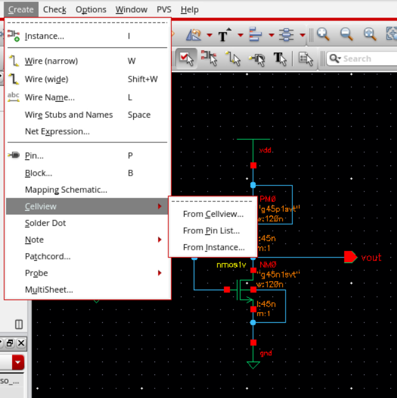

Na janela **Cellview From Cellview**, conferir:

| Campo | Valor |
| --- | --- |
| Library Name | `minicurso_cmos` |
| Cell Name | `a2_inv` |
| From View Name | `schematic` |
| To View Name | `symbol` |
| Tool / Data Type | `schematicSymbol` |
| Display Cellview / Edit Options | Marcados |

Confirmar em **OK**.

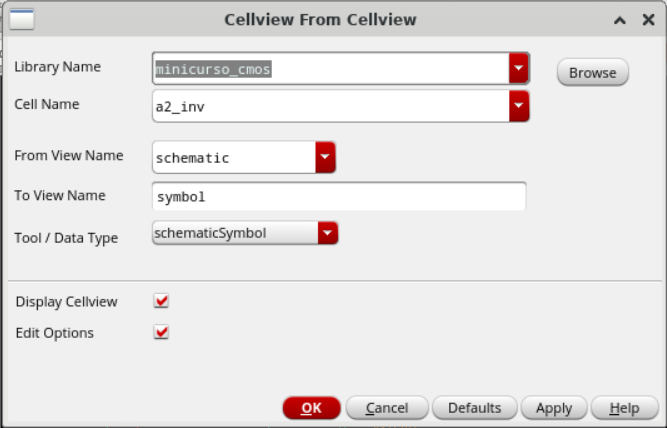

Na janela **Symbol Generation Options**, colocar `vin` em **Left Pins** e `vout` em **Right Pins**. Manter **Top Pins** e **Bottom Pins** vazios, conforme a montagem registrada, e confirmar em **OK**.

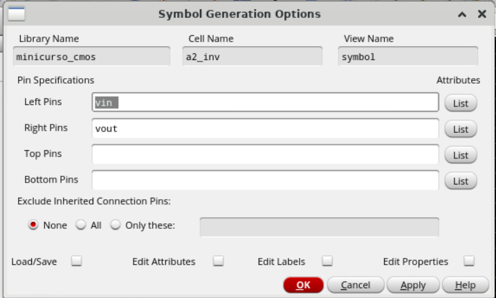

No editor de símbolos, ajustar a representação gráfica para o triângulo com círculo na saída mostrado abaixo, preservando os terminais `vin` e `vout` e seus pontos de conexão. A captura registra o resultado final; as ferramentas de desenho usadas nessa personalização ainda não foram capturadas. Preservar também os rótulos de nome da instância e da célula.

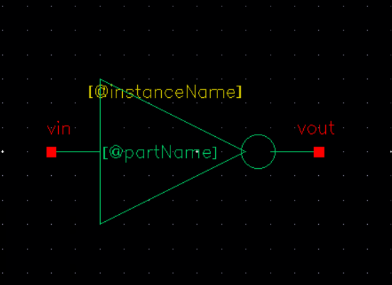

O desenho identifica a função inversora para quem monta o circuito de teste. O comportamento elétrico continua definido pelos transistores e conexões da vista `schematic`; o desenho do símbolo não substitui esse circuito.

Salvar a vista e conferir no Library Manager a presença de **schematic** e **symbol** na mesma célula `a2_inv`.

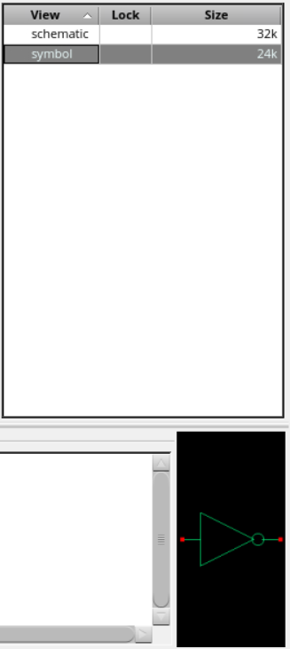

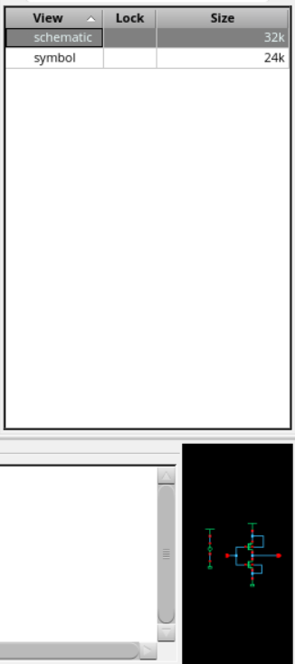

**Alimentação nesta versão:** o símbolo expõe apenas `vin` e `vout`. VDD e terra continuam nas redes usadas no schematic. A prévia do schematic ainda mostra a fonte de alimentação interna; ao montar o testbench, conferir essa alimentação e evitar adicionar outra fonte ideal à mesma rede já alimentada. A ausência de pinos de alimentação no símbolo não elimina a necessidade de alimentar os transistores.

**Checkpoint:** inserir `minicurso_cmos/a2_inv/symbol` no schematic de `a2_tb_inv`, conectar a fonte de entrada a `vin` e selecionar a tensão de `vout` como saída. Registrar a montagem antes de configurar a análise DC.

### 3. Montar o testbench do inversor

No schematic de `a2_tb_inv`, inserir o símbolo `minicurso_cmos/a2_inv/symbol`. A captura mostra a instância `I0`, uma fonte de entrada `V0` referenciada ao terra e a saída `vout`.

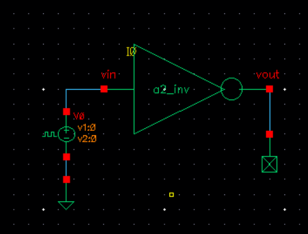

| Elemento | Conexão ou função |
| --- | --- |
| `I0` (`a2_inv`) | Instância da porta inversora |
| Fonte `V0` | Terminal positivo ligado à entrada `vin`; terminal negativo ligado ao terra |
| Nó `vout` | Ligado à saída do inversor; selecionar sua tensão no ADE |
| Alimentação | Mantida no schematic interno de `a2_inv`, conforme a montagem anterior |

A fonte apresenta o desenho de um estímulo pulsado e anotações de dois níveis. A biblioteca, a célula da fonte e os parâmetros completos de tensão e tempo serão registrados na captura de propriedades; não deduzir período, largura ou tempos de transição apenas pelo desenho.

A saída inclui um marcador gráfico cuja função não está identificada nesta captura. Não há capacitor de carga explicitamente identificado; registrar qualquer carga adicional se ela for incluída no teste.

**Checkpoint:** executar Check and Save e conferir a alimentação da instância. Capturar as propriedades de `V0` para documentar os níveis de entrada e, para a análise transiente, atraso, subida, descida, largura e período. Para obter a curva DC, definir e varrer o valor DC da fonte ou usar uma fonte DC com variável de entrada, registrando a configuração efetivamente utilizada. A forma de pulso, por si só, não define a varredura DC.

### 4. Observar a resposta transiente do inversor

Executar a análise **tran** e visualizar as tensões de **`/vin`** e **`/vout`**. A captura registra uma janela de **0 a 40 ns**, com as duas tensões em painéis separados e o mesmo eixo de tempo.

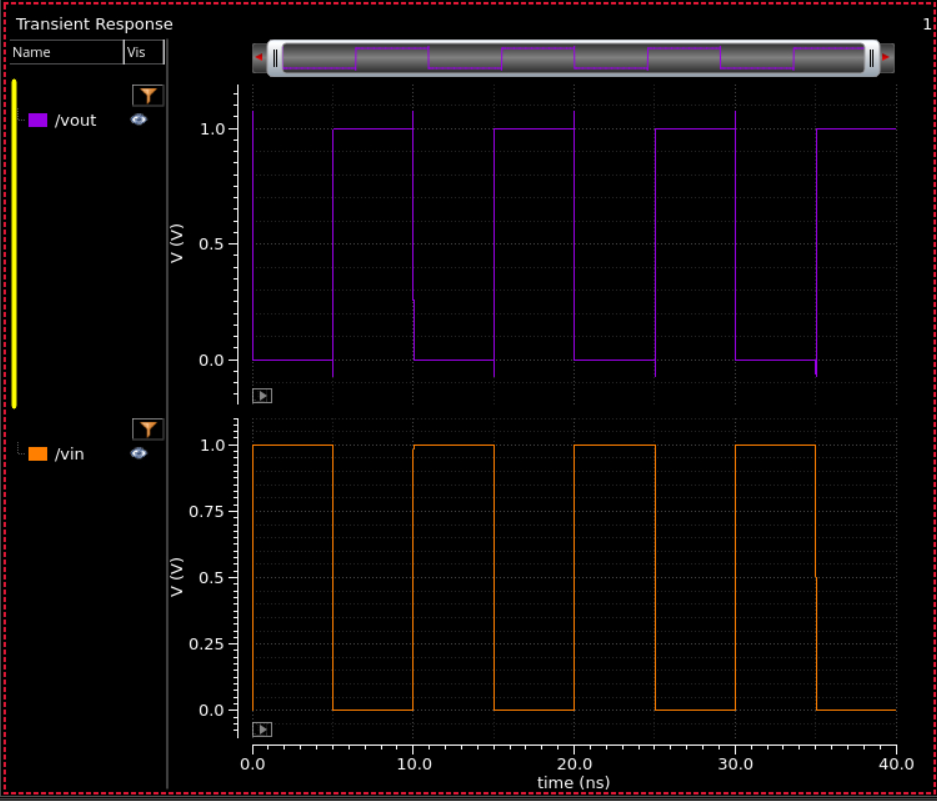

| Traço | Sinal | Leitura |
| --- | --- | --- |
| Roxo, painel superior | `/vout` | Saída do inversor |
| Laranja, painel inferior | `/vin` | Entrada pulsada entre aproximadamente 0 e 1 V |

Nos intervalos estáveis, a saída é complementar à entrada: **Vin alto → Vout baixo**; **Vin baixo → Vout alto**. Relacionar esse resultado aos caminhos elétricos: entrada baixa habilita o caminho de carga pelo PMOS; entrada alta habilita o caminho de descarga pelo NMOS.

A forma de onda exibida começa com a entrada alta e apresenta transições aproximadamente a cada 5 ns, compatíveis com um período próximo de 10 ns. O preenchimento exato dos campos do `vpulse` e da análise transiente ainda precisa da captura de configuração; não tratar os valores anteriormente sugeridos como confirmação dos parâmetros efetivamente usados.

Há pequenos picos na saída próximos às transições da entrada. Registrar a observação sem atribuir uma causa apenas pela imagem. Para investigá-los, ampliar uma borda e conferir os tempos de subida/descida da fonte, a carga, a resolução de simulação e os resultados numéricos. A escala geral não permite medir com precisão atraso de propagação ou amplitude desses picos.

**Perguntas para a turma:** por qual transistor a saída carrega quando a entrada cai? Por qual transistor ela descarrega quando a entrada sobe? Qual é o valor lógico da saída em cada intervalo estável?

**Checkpoint:** a resposta temporal inversora foi registrada. Acrescentar as propriedades do `vpulse` e a configuração de `tran` para completar a reprodução. Nesta aula, a resposta transiente será usada para verificar o funcionamento lógico do inversor; a curva de transferência DC não será realizada. Em seguida avançar para NAND e NOR.

### 5. Próximas práticas

- Usar a resposta transiente já registrada como verificação lógica do inversor; a curva DC foi retirada do escopo desta aula.
- Completar as capturas de configuração do pulso e da análise transiente, cujo resultado já foi registrado.
- Construção e simulação da NAND de duas entradas.
- Construção e simulação da NOR de duas entradas.
- Conferência das tabelas-verdade a partir dos caminhos de carga e descarga.

### 6. Montar os schematics de NAND e NOR

Repetir o fluxo de criação de célula e símbolo utilizado no inversor. Usar dois PMOS e dois NMOS por porta, inicialmente com os mesmos parâmetros registrados no inversor: W = 120 nm, L = 45 nm e multiplicador 1. Esses valores são um ponto de partida didático, sem buscar igualar os atrasos das portas.

| Célula | Rede pull-up: entre VDD e a saída | Rede pull-down: entre a saída e GND |
| --- | --- | --- |
| `a2_nand2` | Dois PMOS em paralelo | Dois NMOS em série |
| `a2_nor2` | Dois PMOS em série | Dois NMOS em paralelo |

Nomear as entradas `a` e `b` e a saída `y`. Em cada porta, conectar `a` à porta de um PMOS e à de um NMOS; conectar `b` às portas dos outros dois dispositivos. Ligar os corpos de todos os PMOS a VDD e os corpos de todos os NMOS a GND, inclusive nos transistores em série: corpo não deve ser ligado automaticamente ao nó intermediário da pilha. Na pilha NMOS, orientar os dispositivos com as fontes em direção a GND; na pilha PMOS, com as fontes em direção a VDD.

**NAND:** a saída descarrega apenas quando as duas entradas estão altas. **NOR:** a saída carrega apenas quando as duas entradas estão baixas.

| a | b | NAND | NOR |
| --- | --- | --- | --- |
| 0 | 0 | 1 | 1 |
| 0 | 1 | 1 | 0 |
| 1 | 0 | 1 | 0 |
| 1 | 1 | 0 | 0 |

**Próximo checkpoint:** capturar primeiro o schematic de `a2_nand2`, conferir as ligações e executar Check and Save. Depois repetir para `a2_nor2`. As montagens da NAND e da NOR estão registradas nos pontos 7 e 10, respectivamente. Em seguida criar os símbolos e testbenches e aplicar estímulos que percorram as quatro combinações, conferindo as saídas após o assentamento das transições.

### 7. Conferir o schematic da NAND

A montagem enviada utiliza dois PMOS em paralelo entre VDD e a saída e dois NMOS em série entre a saída e GND, com alimentação de **1 V**. As anotações dos dispositivos mostram **W = 120 nm**, **L = 45 nm** e multiplicador **1**.

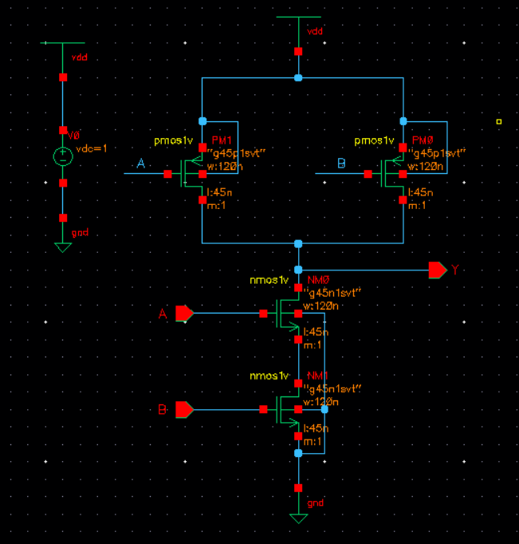

- O PMOS da esquerda é controlado por `A` e o da direita por `B`.
- O NMOS superior é controlado por `A` e o inferior por `B`.
- O nó de saída é a união dos drenos dos PMOS com o dreno do NMOS superior.
- O nó entre os dois NMOS é interno à rede pull-down; não é a saída.
- Os corpos dos PMOS aparecem ligados a VDD e os corpos dos NMOS aparecem ligados a GND, inclusive o corpo do NMOS superior.

**Conferir antes de gerar o símbolo:** o pino de saída `Y` já está conectado ao nó comum dos drenos dos PMOS e do dreno do NMOS superior, conforme a captura atualizada. As conexões de porta dos PMOS aparecem com nomes `A` e `B`, enquanto os pinos de entrada aparecem junto aos NMOS; confirmar no editor que os nomes de rede correspondem exatamente aos pinos e que cada entrada controla seu par PMOS/NMOS. Manter maiúsculas e minúsculas consistentes no schematic, símbolo e testbench; nesta montagem, usar `A`, `B` e `Y`.

**Previsão:** se qualquer entrada estiver em zero, existe caminho de carga por pelo menos um PMOS e a série NMOS fica interrompida. Apenas `A = B = 1` habilita o caminho completo até GND e interrompe os dois PMOS, produzindo saída baixa após o assentamento.

**Checkpoint:** executar Check and Save, confirmar a conectividade e criar a vista `symbol`, com `A` e `B` à esquerda e `Y` à direita. Depois montar o testbench e registrar a resposta transiente para as quatro combinações. A captura documenta a montagem; a resposta transiente da NAND está registrada no ponto 9.

### 8. Criar o símbolo da NAND

Na célula `a2_nand2`, repetir o procedimento do inversor: **Create → Cellview → From Cellview…**, usando `schematic` como origem e `symbol` como destino. Nas opções de geração, posicionar **A e B à esquerda** e **Y à direita**, mantendo os mesmos nomes do schematic.

A captura registra o símbolo final, com o contorno da função AND e o círculo de inversão na saída, identificando a função **NAND**.

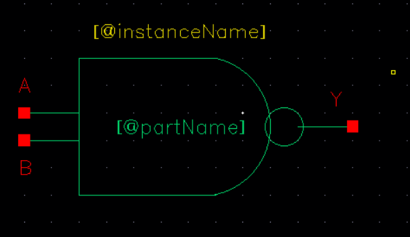

Preservar os pontos de conexão dos três terminais e os rótulos de nome da instância e da célula. Salvar a vista e conferir a existência de `schematic` e `symbol` na mesma célula. O comportamento elétrico continua definido pelo schematic de quatro transistores.

**Checkpoint:** inserir o símbolo em `a2_tb_nand2`, aplicar duas fontes de entrada e medir a tensão de `Y`. Os estímulos devem percorrer as quatro combinações de A e B; esperar saída baixa somente quando ambas estiverem altas. Conferir a alimentação interna da célula antes de acrescentar fontes no testbench, evitando fontes ideais duplicadas na mesma rede. O resultado transiente está registrado no ponto 9 e a montagem do testbench no ponto 13.

### 9. Conferir a resposta transiente da NAND

A captura mostra as entradas **A** (vermelho), **B** (verde) e a saída **Y** (magenta), em uma janela de **0 a 40 ns**, com níveis próximos de 0 e 1 V.

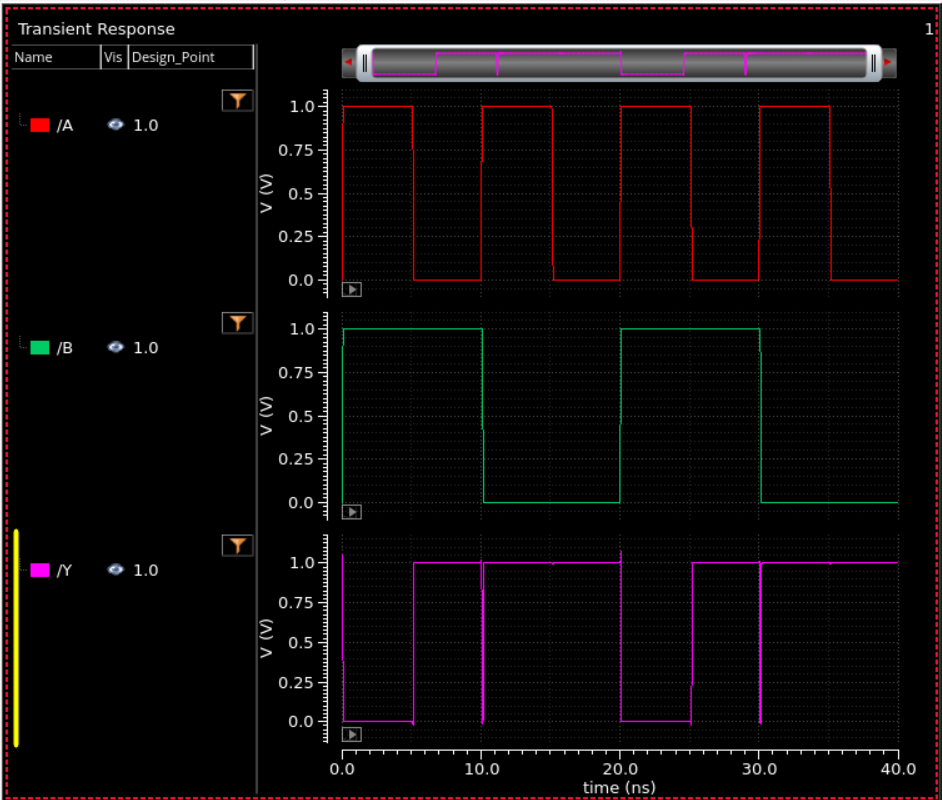

No resultado efetivamente apresentado, **A alterna mais rápido que B**. Portanto, a ordem dos estímulos difere da sugestão anterior de configuração das fontes. Usar a captura como referência para interpretar o teste; as propriedades das fontes ainda precisam ser registradas para reproduzir exatamente os tempos e a condição inicial utilizados.

Conferir a tabela-verdade em instantes afastados das bordas:

| Instante aproximado | A | B | Y observado |
| --- | --- | --- | --- |
| 2 ns | 1 | 1 | 0 |
| 7 ns | 0 | 1 | 1 |
| 12 ns | 1 | 0 | 1 |
| 17 ns | 0 | 0 | 1 |

Nos intervalos estáveis, a saída fica baixa apenas quando ambas as entradas estão altas, confirmando **Y = NOT(A AND B)**. Com A e B altos, os dois NMOS em série estabelecem o caminho até GND. Nas demais combinações, a série é interrompida e pelo menos um PMOS fornece o caminho de carga a partir de VDD.

**Escopo desta prática:** os glitches e os pequenos picos próximos às transições serão desconsiderados nesta etapa. A avaliação da tabela-verdade considera os valores após o assentamento; não é necessário investigar ou corrigir os transientes breves neste exercício.

**Checkpoint:** a resposta lógica da NAND foi registrada para as quatro combinações. O testbench e os parâmetros informados para as fontes e a análise `tran` estão documentados no ponto 13. O próximo circuito é a NOR: PMOS em série e NMOS em paralelo.

### 10. Montar e conferir o schematic da NOR

Na célula `a2_nor2`, montar dois PMOS em série entre VDD e a saída e dois NMOS em paralelo entre a saída e GND. As anotações dos quatro dispositivos mostram **W = 120 nm**, **L = 45 nm** e multiplicador **1**.

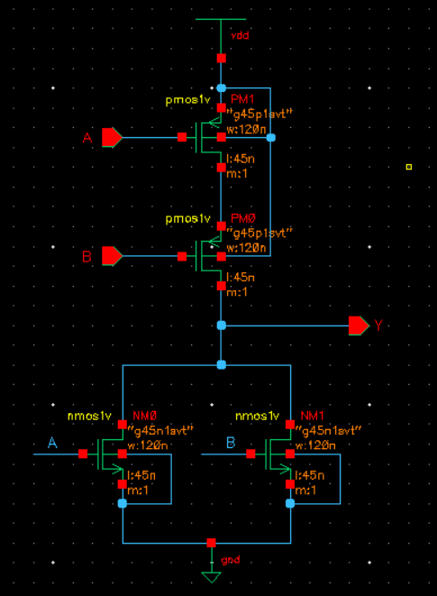

| Elemento | Conexão |
| --- | --- |
| PMOS superior | Porta em `A`; fonte em VDD; dreno ligado à fonte do PMOS inferior |
| PMOS inferior | Porta em `B`; dreno ligado à saída `Y` |
| Dois corpos PMOS | VDD, inclusive o corpo do PMOS inferior |
| NMOS da esquerda | Porta em `A`; dreno em `Y`; fonte e corpo em GND |
| NMOS da direita | Porta em `B`; dreno em `Y`; fonte e corpo em GND |

A saída `Y` está no nó comum ao dreno do PMOS inferior e aos drenos dos dois NMOS. O nó entre os PMOS é interno à rede pull-up; não é a saída. As portas dos NMOS aparecem ligadas por nomes de rede `A` e `B`; conferir no editor que esses nomes correspondem exatamente às entradas junto aos PMOS.

**Previsão antes da simulação:** apenas `A = B = 0` habilita os dois PMOS em série e interrompe os dois NMOS, permitindo saída alta. Se qualquer entrada estiver alta, pelo menos um NMOS fornece caminho até GND e a série PMOS é interrompida, produzindo saída baixa após o assentamento.

A captura mostra os símbolos VDD e GND, mas não mostra uma fonte de alimentação. Garantir **1 V entre VDD e GND** no circuito de teste ou na alimentação já adotada no projeto; os símbolos, isoladamente, não geram tensão.

**Checkpoint:** executar Check and Save, conferir conexões e gerar a vista `symbol` com `A` e `B` à esquerda e `Y` à direita. Em seguida montar `a2_tb_nor2` e repetir os estímulos de duas entradas usados na NAND, medindo A, B e Y. A resposta transiente da NOR está registrada no ponto 12.

### 11. Criar o símbolo da NOR

Na célula `a2_nor2`, repetir o fluxo **Create → Cellview → From Cellview…**, gerando a vista `symbol` a partir de `schematic`. Posicionar os pinos **A e B à esquerda** e **Y à direita**, preservando exatamente os nomes usados no circuito.

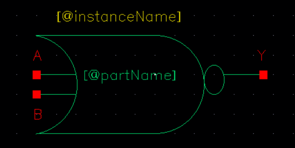

A captura mostra o contorno da função OR com um círculo de inversão na saída, representando **NOR**. Preservar os pontos de conexão dos terminais e os rótulos de nome da instância e da célula. Salvar a vista e conferir as vistas `schematic` e `symbol` no Library Manager. O comportamento elétrico continua definido pelos quatro transistores do schematic.

**Checkpoint:** inserir o símbolo em `a2_tb_nor2`, garantir a alimentação de 1 V e conectar duas fontes de pulso às entradas. Reutilizar os estímulos utilizados na NAND e medir A, B e Y. Conferir os intervalos estáveis: a saída deve ficar alta apenas para **A = B = 0**. A resposta transiente está registrada no ponto 12 e a montagem do testbench no ponto 13.

### 12. Conferir a resposta transiente da NOR

A captura apresenta **A em ciano**, **B em roxo** e **Y em laranja**, na janela de **0 a 40 ns**. A alterna mais rápido que B, percorrendo as quatro combinações de entrada.

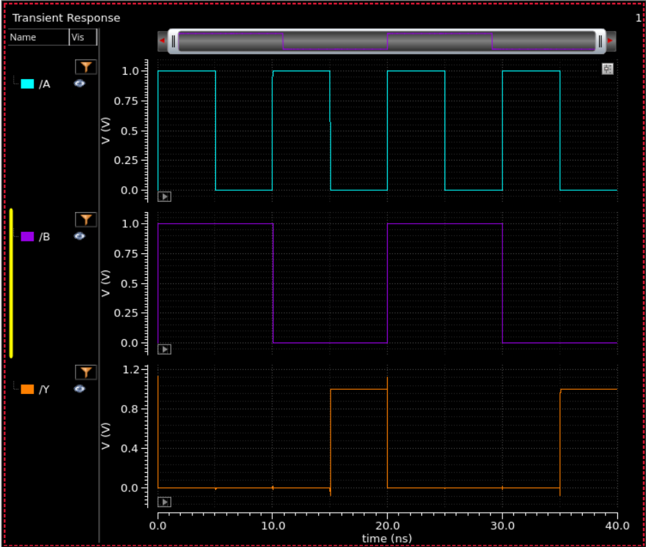

Conferir os valores em instantes afastados das bordas:

| Instante aproximado | A | B | Y observado |
| --- | --- | --- | --- |
| 2 ns | 1 | 1 | 0 |
| 7 ns | 0 | 1 | 0 |
| 12 ns | 1 | 0 | 0 |
| 17 ns | 0 | 0 | 1 |

Nos intervalos estáveis, a saída fica próxima de **1 V somente quando A e B estão em zero**, confirmando **Y = NOT(A OR B)**. Nesse estado, os dois PMOS em série fornecem o caminho de carga e os dois NMOS estão desligados. Com qualquer entrada alta, existe caminho de descarga por pelo menos um NMOS e a série PMOS é interrompida.

Assim como na NAND, os glitches e picos próximos às transições ficam fora da análise desta etapa. Avaliar a tabela-verdade após o assentamento das formas de onda.

**Fechamento da aula 2:** foram registrados os schematics, os símbolos e as respostas transientes de inversor, NAND e NOR. O objetivo de verificar o funcionamento lógico das três portas foi atendido pelos resultados apresentados. Os testbenches de NAND/NOR e a configuração informada para a simulação estão documentados no ponto 13, incluindo as diferenças visíveis nos tempos de subida. A curva DC do inversor permanece fora do escopo por decisão do minicurso. O próximo módulo é o layout do inversor na aula 3.

### 13. Montar os testbenches e configurar os estímulos

Inserir o símbolo da NAND em `a2_tb_nand2` e o símbolo da NOR em `a2_tb_nor2`. Em ambos os casos, ligar uma fonte `vpulse` entre cada entrada e GND e medir as tensões de A, B e Y. Garantir a alimentação de 1 V das redes usadas pelas portas, conforme a organização de alimentação já adotada.

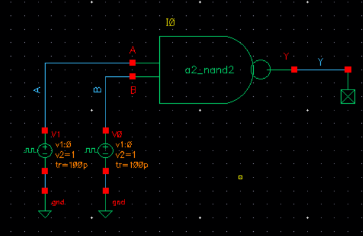

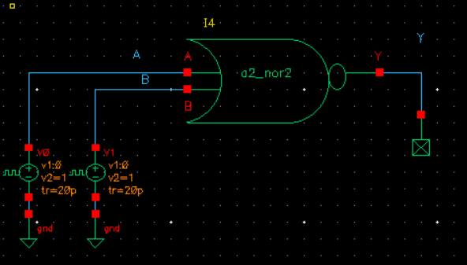

O responsável pela montagem confirmou que utilizou a configuração de fontes sugerida no acompanhamento, com **Delay time = 0**, e que a configuração de **tran** foi apenas **Stop Time = 40n**. Não é necessário exigir capturas adicionais desses formulários para registrar essas informações fornecidas.

| Parâmetro comum às fontes | Valor |
| --- | --- |
| Voltage 1 | `0` V |
| Voltage 2 | `1` V |
| Delay time | `0` |
| Análise | `tran` |
| Stop Time | `40n` (40 ns) |

**Correspondência das entradas:** nos gráficos apresentados, A é a entrada mais rápida, com período aproximado de 10 ns, e B tem período aproximado de 20 ns. Para reproduzir essa ordem, associar a A a fonte com largura de pulso de 5 ns e período de 10 ns, e a B a fonte com largura de 10 ns e período de 20 ns. A tabela sugerida anteriormente no acompanhamento atribuía essas velocidades às entradas opostas; inverter os nomes não muda a função lógica, mas muda a ordem das combinações no gráfico.

**Tempos de transição:** a sugestão inicial foi subida e descida de `100p`. As anotações das novas capturas mostram `tr=100p` nas duas fontes da NAND e `tr=20p` nas duas fontes da NOR. Registrar essa diferença efetivamente visível; os tempos de descida não aparecem nas capturas e a referência informada para eles continua sendo a sugestão de `100p`. Esses detalhes não mudam o critério desta atividade, que verifica os níveis lógicos nos intervalos estáveis e desconsidera os glitches.

Executar a análise e exibir as tensões **A, B e Y**, conforme os resultados dos pontos 9 e 12. A seleção dessas tensões foi confirmada pelos próprios gráficos; a captura específica do menu de seleção é opcional para a documentação.

**Situação da aula 2:** a montagem e a verificação lógica por transiente de inversor, NAND e NOR estão registradas. Os dois testbenches foram acrescentados e a configuração de simulação de 40 ns foi informada pelo responsável. Não há nova simulação obrigatória para encerrar esta etapa. A curva DC do inversor e a investigação dos glitches permanecem fora do escopo.

## Aula 3 — Do schematic ao layout

**Objetivo:** construir a implementação física do inversor e relacionar os dispositivos e as interconexões ao schematic. Concluir com as verificações DRC e LVS; a simulação após extração está fora do escopo desta aula.

### 1. Preparar o schematic de a3_inv

Usar a célula `minicurso_cmos/a3_inv` com um PMOS e um NMOS, mantendo **W = 120 nm**, **L = 45 nm** e multiplicador **1**, conforme a captura. A fonte ideal de alimentação não aparece no schematic preparado para o layout; ela deve permanecer no circuito de teste.

A montagem registrada mantém os terminais `vin` e `vout` e usa símbolos de alimentação **`vdd_inherit`** e **`gnd_inherit`**, exibindo as referências **`vdd!`** e **`gnd!`**. Portanto, este passo a passo acompanha as conexões herdadas mostradas, em vez da proposta inicial de quatro pinos explícitos `vin`, `vout`, `VDD` e `VSS`. Conferir os nomes efetivos das redes ao gerar terminais físicos e configurar LVS e extração; não substituir esses nomes silenciosamente por nomes locais diferentes.

### 2. Abrir o Layout XL e criar a vista

Com o schematic de `a3_inv` aberto, acessar **Launch → Layout XL**.

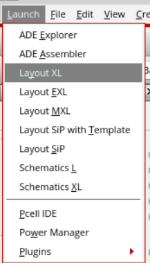

Na janela **Startup Option**, selecionar **Layout: Create New** e **Configuration: Automatic**, conforme a captura, e confirmar em **OK**.

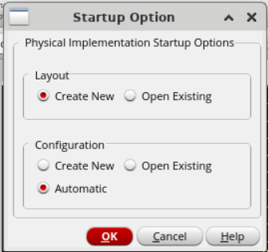

Na janela **New File**, conferir:

| Campo | Valor |
| --- | --- |
| Library | `minicurso_cmos` |
| Cell | `a3_inv` |
| View | `layout` |
| Type | `layout` |
| Open with | `Layout XL` |

Confirmar em **OK**. Isso cria uma nova vista da mesma célula, e não um circuito independente.

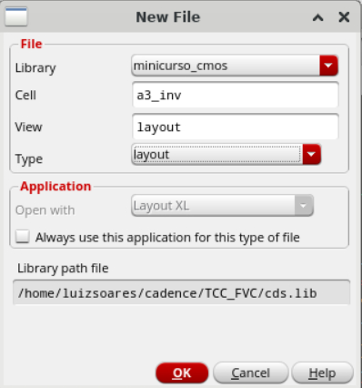

### 3. Reconhecer a área de layout

O editor abre uma área de desenho ainda vazia, com a paleta de camadas da tecnologia **`gpdk045`** à esquerda e uma janela de referência do schematic. A captura ainda não mostra os transistores físicos gerados ou posicionados.

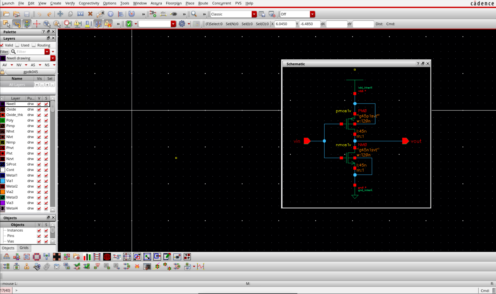

Usar a comparação entre as duas vistas para localizar as futuras conexões: portas unidas em `vin`, drenos unidos em `vout`, fonte e corpo do PMOS na alimentação superior e fonte e corpo do NMOS no terra. Os símbolos de alimentação do schematic não substituem os contatos físicos de poço e substrato que precisarão ser implementados no layout.

**Próximo checkpoint:** abrir o comando de geração dos dispositivos a partir do schematic no Layout XL e capturar suas opções antes de confirmar. Depois registrar os dispositivos gerados, posicionar PMOS acima e NMOS abaixo e iniciar as conexões físicas. Não considerar o layout pronto apenas pela criação da vista.

### 4. Relacionar o layout montado ao schematic

A captura registra o layout montado do inversor ao lado de seu schematic: PMOS na parte superior, NMOS na inferior e conexões de entrada, saída e alimentação desenhadas. As etapas intermediárias de geração, posicionamento e roteamento ainda não foram capturadas; esta imagem documenta o resultado da montagem.

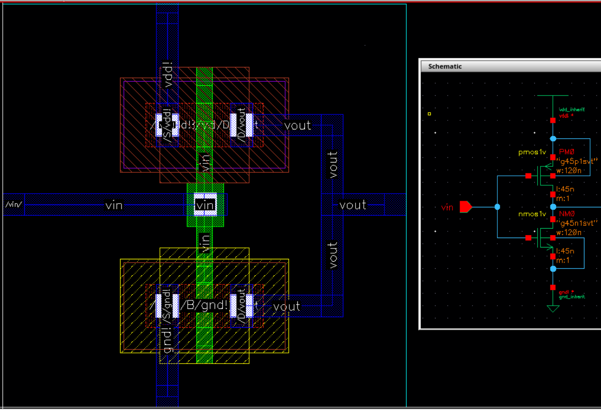

| Parte do circuito | Identificação na imagem |
| --- | --- |
| PMOS | Dispositivo superior, associado à alimentação `vdd!` |
| NMOS | Dispositivo inferior, associado à referência `gnd!` |
| Entrada `vin` | Interconexão horizontal à esquerda com contato para a faixa de porta que une os dois dispositivos |
| Saída `vout` | Interconexão à direita que une os drenos dos dois dispositivos |
| Alimentação superior | Interconexão vertical à esquerda do PMOS, identificada como `vdd!` |
| Referência inferior | Interconexão vertical à esquerda do NMOS, identificada como `gnd!` |

**Leitura guiada:** seguir `vin` até as portas dos dois transistores; seguir `vout` até os dois drenos; localizar as conexões das fontes aos respectivos trilhos. Relacionar cada percurso ao schematic mostrado ao lado. Usar a paleta de camadas para confirmar os nomes das camadas e os contatos, em vez de identificá-los apenas por suas cores.

**Conexões de corpo:** as anotações de corpo aparecem nos dispositivos, mas a imagem, isoladamente, não comprova a implementação e a continuidade dos contatos de poço e substrato. Conferir no layout os contatos físicos e sua ligação a `vdd!` no PMOS e `gnd!` no NMOS. Um nome de rede ou uma anotação de terminal não substitui essa verificação.

**Situação:** a montagem física foi apresentada. Ainda não foram registrados resultados de DRC, LVS ou extração; portanto, o roteiro não declara o layout aprovado nem uma simulação após extração concluída.

**Próximo checkpoint:** registrar a configuração e o relatório de DRC; depois conferir LVS contra `a3_inv/schematic`, incluindo terminais, nomes das redes e contatos de corpo. Corrigir os erros indicados antes da extração e da comparação de simulações.

### 5. Etapas seguintes

- Completar as capturas das etapas intermediárias de geração e posicionamento dos dispositivos, reconhecendo as camadas do PDK.
- Conferir os contatos de corpo, os pinos físicos e as conexões de entrada, saída e alimentação com as regras da tecnologia.
- Executar DRC e LVS e registrar os resultados.
- Registrar os relatórios finais de DRC e LVS.
- Encerrar a prática após DRC e LVS; extração de parasitas e simulação após extração não serão realizadas nesta aula.

### 6. Configurar a tecnologia de verificação no Assura

Ao abrir o LVS inicialmente, a tecnologia aparecia como `-undefined-`, sem regras preenchidas, e o formulário impediu a execução por falta de regras de extração ou RSF Include. Esse erro era de configuração anterior à verificação do layout.

O caminho da biblioteca foi consultado na CIW com:

```lisp
ddGetObj("gpdk045")~>readPath
```

Resultado informado no ambiente do minicurso:

```text
/home/tools/cadence/gpdk/gpdk045_v_6_0/gpdk045
```

Em **Assura → Technology…**, selecionar o arquivo de configuração:

```text
/home/tools/cadence/gpdk/gpdk045_v_6_0/assura_tech.lib
```

Esse caminho é específico do servidor usado nesta prática. Em outra instalação, localizar o arquivo correspondente no PDK instalado.

### 7. Conferir a configuração de DRC

Abrir **Assura → Run DRC**. A captura mostra a tecnologia **`gpdk045_av`**, o Rule Set **`default`** e o arquivo `assura/assuraDRC.rul` preenchido. O design é `minicurso_cmos/a3_inv/layout`, com **Area To Be Checked = Full**.

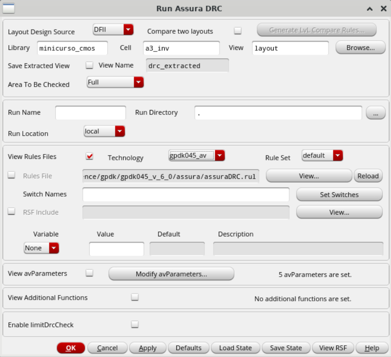

Preencher **Run Name**, por exemplo `a3_inv_drc`, e escolher um **Run Directory** com permissão de escrita. A captura ainda mostra Run Name vazio e Run Directory como `.`. Executar, examinar o relatório e corrigir as violações antes de prosseguir. Ainda não foi apresentado um resultado de execução do DRC.

### 8. Conferir a configuração de LVS

Abrir **Assura → Run LVS**. Selecionar o schematic e o layout da mesma célula `minicurso_cmos/a3_inv`. A captura mostra **Technology = gpdk045_av**, **Rule Set = default** e os arquivos reconhecidos:

- `assura/extract.rul` em Extract Rules.
- `assura/compare.rul` em Compare Rules.
- `assura/LVSinclude.rsf` em RSF Include.

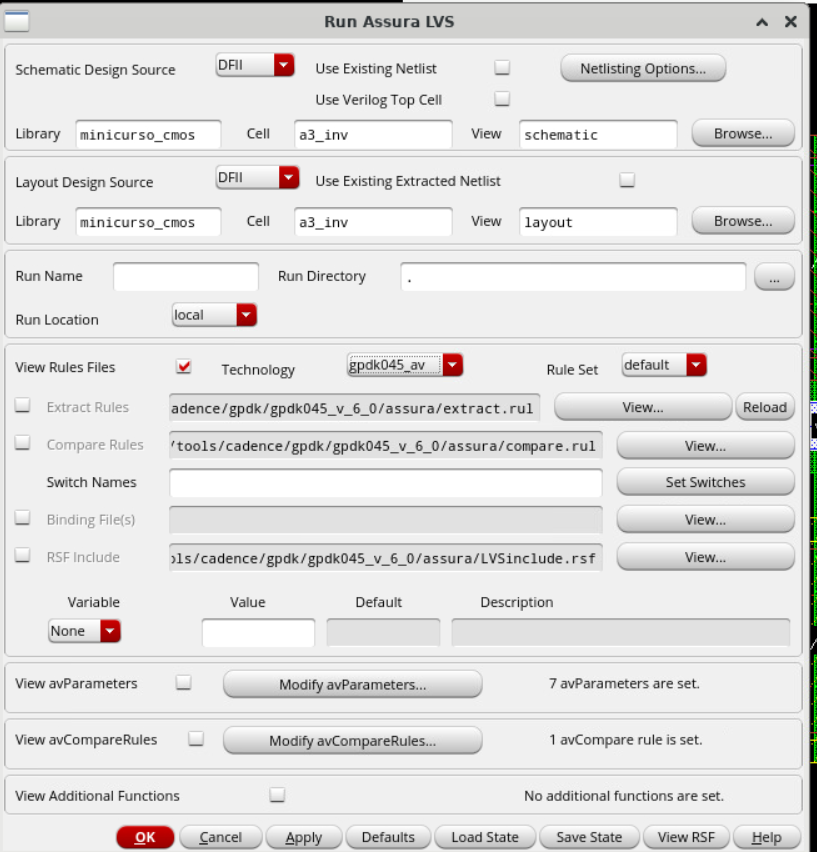

Preencher **Run Name**, por exemplo `a3_inv_lvs`, e usar um diretório de execução com permissão de escrita, preferencialmente separado do DRC. Executar e registrar a comparação entre schematic e layout. Os arquivos preenchidos confirmam o reconhecimento da configuração, mas ainda não comprovam que o LVS foi executado ou que os circuitos correspondem.

**Critério de fechamento da aula 3:** registrar DRC sem violações e LVS com correspondência entre schematic e layout. Se forem necessárias alterações no layout durante a correção, repetir as verificações pertinentes. Por decisão do minicurso, esta aula termina em DRC e LVS; extração de parasitas e simulação após extração ficam fora do escopo.
